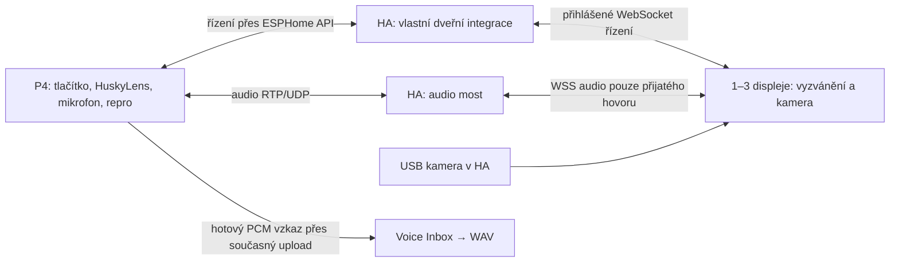

# D6 / etapa A — vlastní dveřní interkom: posouzení

Datum: 25. 10. 2026. Jen průzkum a návrh; žádný nový firmware, YAML, nasazení ani změna HA.

**Závěr:** popsaný zvonek je realizovatelný. Nejmenší cestou je vlastní ovládání,
pravidla zvonku a hlasová schránka nad stávajícím hovorem. Úplné odstranění HA
integrace VoIP Stack je také možné, ale znamená převzít správu spojení a audio
most. Odstranění i ESP komponenty `voip_stack` znamená navíc nový přenosový
modul na každém přijímacím ESP. Samotné `esp_audio_stack` lze ponechat ve všech
variantách jako ovladač sdíleného mikrofonu/reproduktoru.

Označení v této zprávě:

- **OVĚŘENO VE ZDROJÍCH**: doloženo uvedenou revizí, nikoli automaticky provozem v tvém HA.
- **OVĚŘENO UŽIVATELEM**: dosavadní obousměrný hovor, kamera, HuskyLens a záznam z prohlížeče do HA.
- **NÁVRH / ODHAD**: rozhodnutí pro vlastní systém, zatím nenaprogramované.
- **NEOVĚŘENO**: vyžaduje zkoušku konkrétního hardwaru nebo instalace.

## 1. Výchozí stav a důležitá rozlišení

Prohlédnuté místní revize:

| Část | Revize | Co to znamená |
|---|---|---|
| HA interkom + karta | `6581cfea712d0e13bf88c5aff3fa97b9e27123ab` | Místní manifest má verzi 2026.10.1; přesnou nainstalovanou verzi HA integrace jsme neověřili |
| ESP SIP/RTP telefon | `c693b4e75008afb5d2f584a09035aee2743a2210` | Současná připnutá komponenta `voip_stack` v D4 |
| ESP audio hardware | `0482d741a938378ef948e3b8f3dd31536f9f2cc9` | Současné `esp_audio_stack`, ES8311, sdílené I2S |

Aktuální veřejné repozitáře jsem také otevřel; konkrétní rozhraní níže vztahuji
k prohlédnutým revizím, nikoli k pohyblivému hlavnímu vývoji. [S1–S3]

Je nutné rozlišit tři vrstvy: **audio hardware v ESP**, **přenos hovoru** a
**zvonková logika/obrazovka v HA**. Vlastní obrazovka nemusí znamenat vlastní
RTP nebo vlastní I2S ovladač. Piny, kodek a nynější 48 kHz / 16 bit / mono není
pro tento záměr potřeba měnit. Audio Stack poskytuje mikrofonní callbacky a
registraci spotřebitelů; nejde o vlastnost omezenou na VoIP. [S3]

Náš D5 rekordér je naopak zatím explicitně svázaný s `voip_stack`: má
`phone_id`, závislost v Python schématu a používá `phone_->is_idle()`.
Při úplném odstranění VoIP by se tato kontrola musela nahradit stavem vlastního
interkomu. **Nestačí ze současného YAML smazat blok `voip_stack`.** [S12]

## 2. Co už nynější projekt umí

**OVĚŘENO VE ZDROJÍCH:** skupina `ring group` vyzvání více dostupných příjemců,
první přijetí vybere vítěze a ostatní větve zruší. Odmítnutí jedním členem
nemusí ukončit vyzvánění ostatních. Skupinu řídí HA; ESP volá jeden skupinový
kontakt, nerozesílá tři nezávislé hovory. [S4]

Dokumentace uvádí automatizační spouštěče `voip_stack.route_requested`,
`voip_stack.call_unanswered`, `voip_stack.call_connected`, `voip_stack.call_ended`
a další. `call_unanswered` znamená, že dosud vyzvání po určitou dobu, nikoli
totéž co ukončený hovor. Je nutné pracovat s konkrétním hovorem a jeho výsledkem,
ne reagovat na každé `idle` jako na nezvednutí. Jména zde označují rozhraní
projektu; netvrdím, že jsou všechna prosté názvy událostí na sběrnici HA. [S5]

V dokumentaci je výslovně uvedeno, že menu samo hlasovou schránku nenahrává.
To již řešíme samostatně přes Voice Inbox. **D5 nahrávání přímo z P4 zatím čeká
na tvůj test**; úspěšná kompilace a browserový záznam ho nenahrazují. [S5, S12]

**Obraz kamery nemusíme přestavovat na SIP video.** Prohlédnutá karta umí
vytvořit standardní HA `picture-entity` s `camera_view: live` pro
`camera_entity_id`. Tím lze ponechat samostatnou kamerovou entitu a vedle ní
ovládání hovoru. To odpovídá dosavadnímu chování u tebe. [S6]

## 3. Srovnání cest

Následující náročnost je **můj technický odhad**, nikoli slíbená dodací lhůta.

| Varianta | Co zůstane | Co vytvoříme | Náročnost / nezávislost |
|---|---|---|---|
| A — vlastní zvonek nad funkčním VoIP | HA VoIP Stack i ESP SIP/RTP a Audio Stack | Dveřní obrazovka, režimy doma/pryč, tlačítko, výzvy, propojení schránky | Nejmenší; plná kontrola chování, ale závislost na HA VoIP zůstává |
| B — vlastní odvozená HA integrace, ponechané SIP ESP | ESP `voip_stack` + Audio Stack | Vlastní HA registr zařízení, řízení hovorů, skupina, audio most, UI; převzaté části s licencí | Velká; bez původní HA integrace, ale udržujeme její odvozený kód a ESP SIP komponentu |
| C — vlastní malý dveřní systém bez VoIP Stacku | Audio Stack, kamera, HuskyLens, Voice Inbox | Vlastní řízení spojení, ESP audio transport, HA most, UI a případně firmware přijímačů | Největší; největší volnost a odpovědnost za kvalitu spojení |

**Moje doporučení:** pro první použitelný zvonek A. Vlastní pravidla zvonku
navrhnout jako oddělenou vrstvu s úzkým rozhraním pro zahájení/přijetí/ukončení
hovoru. Později lze zaměnit přenos, aniž se znovu píše schránka, stavy návštěvy
a ovládání displeje.

**Pokud je úplné odstranění HA VoIP podmínka**, rozhodovat mezi B a C až po
určení přijímacích zařízení. Pro již fungující ESP SIP telefony je B přirozenější.
Pro jednu P4 a pouze webové panely je C s malým pevným profilem audia rozumný
samostatný projekt. Není to však drobné rozšíření nynějšího YAML.

## 4. Co lze převzít a co nelze jednoduše vytrhnout

**OVĚŘENO VE ZDROJÍCH:** prohlédnuté tři projekty mají kořenovou MIT licenci.
Převzetí projektového kódu dovoluje při zachování uvedených autorských a
licenčních oznámení. U závislostí a jednotlivých převzatých souborů je nutné
ponechat jejich vlastní licence. Převzatý kód musí zůstat označený jako převzatý,
včetně revize; nemá být vydáván za naši původní implementaci. [S7]

| Část | Zjištění | Praktický závěr |
|---|---|---|
| `core/rtp.py` | Pomocné funkce pro RTP, standardní knihovna, bez přímých HA importů | Dobrý kandidát pro převzetí spolu s relevantními testy |
| `core/audio_format.py`, `core/audio_pcm.py` | Formáty a převod PCM; převod používá NumPy | Oddělitelné po prověření závislostí a verzí |
| `audio_ws.py` | Krátké rámování browserového audia | Snadno oddělitelné, ale samo nepřenáší ani neřídí hovor |
| Audio worklety | Rámování, zpracování/převzorkování a přehrávání v prohlížeči | Znovupoužitelné po sjednocení formátu a zpráv s naším backendem |
| `audio_ws_view.py` | 19 přímých relativních importovaných modulů/skupin | Není samostatný přijímač; závisí na hovoru, identitě, stavu a vlastníkovi zvuku |
| `sip_rtp_bridge.py` | 8 takových přímých importů | Potřebuje okolní SIP/session logiku i úklid prostředků |
| `ring_group_orchestrator.py` | 26 takových přímých importů | Vytržení skupinového volání znamená zásah do orchestrace a životnosti hovorů |

Počty vznikly statickou analýzou importů daných souborů v revizi S1; zahrnují
i typové/lokální importy a nejsou počtem všech tranzitivních závislostí. [S8]

Proto nedoporučuji začít hromadným mazáním všeho „nepotřebného“ z projektu.
U varianty B nejdřív ponechat funkční celek jako výchozí bod, vytvořit vlastní
doménu a odstranit funkce po ověřitelných krocích. Původní a odvozený backend
nesmějí současně řídit stejný hovor nebo si konkurovat na stejných SIP portech.

## 5. Jak by fungovala vlastní komunikace

**NÁVRH pro variantu C, první verze jen v domácí LAN:**

To jsou **navržené kanály**, nikoli hotové volby YAML. Pro variantu A zůstane
SIP/RTP a audio most VoIP Stacku a mění se hlavně řízení zvonku/UI.

- **Řízení:** nativní šifrované ESPHome API pro tlačítko, stavy a příkazy;
  HA rozhoduje koho vyzvat. Browser ovládá vlastní HA integraci autentizovanými
  WebSocket příkazy. Existující HA API podporuje autorizované příkazy a odběr
  událostí; nové názvy a jejich význam bychom teprve navrhli. [S9]
- **Živý zvuk:** P4 potřebuje ohraničené fronty, RTP sekvence/časování,
  přijímací jitter buffer, doplnění ztracených rámců a bezpečný konec relace.
  HA pro webový panel převádí RTP na binární WebSocket audio a zpět.
  Současný projekt tuto mediální cestu opravdu používá; URL si karta nechává
  podepsat přes přihlášené HA spojení. [S8]
- **Přijetí:** 1–3 displeje dostanou výzvu a obraz, ale obousměrný zvuk se spojí
  jen s jedním vítězem. Nejde o konferenci se třemi mikrofony.
- **Autorizace:** výhra musí být atomická podle identifikátoru návštěvy/hovoru;
  opožděné kliknutí nesmí převzít již přijatý nebo ukončený hovor. Samotné známé
  IP nebo číslo hovoru nesmí být jediným oprávněním k audiospojení.
- **Uložený vzkaz:** ponechat oddělený současný upload do Voice Inboxu.
  Klíč opravňující k uploadu se nesmí automaticky stát klíčem k odposlechu
  nebo ovládání interkomu. První verze nemusí ukládat zvuk v HA během hovoru.
- **Instalace:** vlastní HA integrace může mít UDP i WSS část uvnitř Core,
  podobně jako prohlédnutý VoIP Stack. Není nutné hned zavádět doplněk nebo další
  Proxmox VM. Bezblokující I/O, omezené fronty a úklid při restartu jsou ale naše práce.

**WebRTC jako jiná cesta:** může dávat smysl později pro internetové klienty,
ale k ESP RTP přidává kompatibilní mediální bránu, vyjednání a ICE/STUN/TURN
podle topologie. Není to pouhá náhrada URL. První vlastní LAN verzi bych tím
nezatěžoval. Nabu Casa nelze automaticky považovat za obecný UDP/RTP tunel;
návrh vzdáleného hovoru by byl samostatně ověřovaný. [S10]

## 6. Displej je zásadní podmínka, nikoli dostačující vlastnost

**NEOVĚŘENO:** zatím chybí konkrétní modely a způsob provozu tří přijímačů.
Rozbor tedy zahrnuje obě možnosti; jejich skutečnou kombinaci nepotvrzuji.

| Přijímač | Co je třeba navíc |
|---|---|
| Tablet / PC / panel s HA v prohlížeči | Mikrofon, reproduktor, HTTPS, povolení mikrofonu, běžící stránka a povolené přehrávání; vlastní karta/panel |
| ESP32 s displejem/LVGL | Kompatibilní firmware, mikrofon a reproduktor, klient hovoru a dekódování/zobrazení obrazu; HA karta na něm neběží |
| Směs obojího | Jeden společný stav hovoru a dvě implementace klienta; vlastní systém tím výrazně naroste |

**HTTPS je potřeba i pro panel → ESP**, pokud se používá mikrofon prohlížeče.
Cílové zařízení na tom nic nemění. Dřívější funkční test na HTTP mohl využívat
už nastavenou výjimku prohlížeče. Taková výjimka není obecné řešení pro všechny
panely. Samotný obraz nebo přehrání předem připravené odpovědi mikrofon nepotřebují. [S11]

Zvonění na zamčeném/uspaném panelu není totéž jako zavolat na běžící stránku.
Je třeba ověřit probouzení displeje, kiosk režim a politiku automatického
přehrávání. Logický stav „vyzvání“ nezaručuje, že zařízení zvonění skutečně
přehrálo. Návrh musí sledovat dostupnost klienta a po timeoutu přejít na vzkaz. [S5, S11]

Pro ESP displej nabízí `online_image` získávání a dekódování obrázků z URL,
což je kandidát pro náhled/sérii snímků. **Nedokazuje to plynulé 720p video**.
Rozlišení, obnovování, autorizaci a zátěž JPEG je třeba vyzkoušet na konkrétním
přijímači. Pro browser lze využít již fungující kamerovou entitu v HA. [S6, S13]

## 7. Navržené chování zvonku

Následující tabulka je návrh, nikoli současná implementace.

| Situace | Reakce |
|---|---|
| HuskyLens zaznamená obličej | Událost návštěvy, snímek USB kamery; omezit opakování při trvalé přítomnosti |
| První stisk zvonku, režim doma | Upozornění a vyzvánění 1–3 vybraných displejů, zobrazit kameru |
| Displej zvolí Přijmout | První potvrzený příjemce získá hovor, ostatním se vyzvánění zruší |
| Displej zvolí Přehrát odpověď | Atomicky převezme vyřízení návštěvy, zruší vyzvánění ostatních a spustí zvolenou odpověď u dveří |
| Jeden panel jen odmítne | Ostatní mohou dál vyzvánět; odmítnutí není totéž jako vyřízení celé návštěvy |
| Nikdo nezvedne / nikdo není doma | Přehrát výzvu, například „Právě nemůžeme otevřít. Pro zanechání vzkazu stiskněte tlačítko.“ |
| Stisk po skončení výzvy | Tón, potom spustit záznam návštěvníka |
| Další stisk při záznamu | Zastavit a uložit; jinak automatické zastavení na časovém limitu |
| Uložení potvrzeno HA | Krátké potvrzení návštěvníkovi a upozornění domácnosti |
| Chyba uploadu / plná schránka | Nevyslovit „vzkaz uložen“; ukázat chybu v HA a srozumitelně oznámit neúspěch |

Detekce obličeje a fyzické zazvonění mají rozdílný význam. Návrh automaticky
nevolá pokaždé, když HuskyLens detekuje obličej, a nerozšiřuje odemykání dveří.
Snímek USB kamery bude časově přiřazený k detekci; bez kalibrace nezaručíme,
že je to přesně stejný výřez obličeje jako u HuskyLens.

Tlačítko musí mít odrušení, blokaci dvojstisků a význam podle stavu. Stisk během
přehrávané instrukce se v prvním návrhu ignoruje; nahrávání se povolí až po tónu.
Při vyzvánění další stisk nezaloží nový souběžný hovor. Konkrétní GPIO a elektrické
zapojení **NEOVĚŘENO** — před změnou YAML ověřit volný vyvedený pin a schéma desky.

Přítomnost doma má mít ruční přepnutí režimu a rozumné chování pro `unknown`:
navrhuji při nejasné přítomnosti nejdřív zkusit dostupné displeje. Nebýt doma
a mít nedostupný panel nejsou stejné podmínky.

**Předem připravená odpověď** je zvuk určený návštěvníkovi; **zanechaný vzkaz**
je jeho nahrávka pro domácnost. UI je musí odlišit. Výzvy lze přehrávat stávajícím
media_playerem; pro deterministický průběh čekat na skutečné dokončení přehrávání,
ne na pevné zpoždění. Offline výzva by vyžadovala lokální audio soubor ve firmware;
současná dostupnost takového nouzového režimu se zde neslibuje.

## 8. Výkon, rizika a co měřit

**Výpočet pro dosavadní PCM:** 48 000 × 2 × 1 = 96 000 B/s, tedy 768 kbit/s
v jednom směru a 1,536 Mbit/s obousměrně bez síťové režie. Při 10ms rámcích
jde o 960 B zvuku na rámec. To není zásadní problém kapacity Ethernetu, ale
zpoždění a kolísání front mohou být slyšet i na rychlé síti.

Desetisekundový vzkaz zabere 960 000 B, třicetisekundový 2 880 000 B a
šedesátisekundový 5 760 000 B PCM. Jsou to výpočty zvuku, nikoli celkové RAM
firmware. D5 nyní vyhrazuje pouze desetisekundový buffer. Navýšení délky by
vyžadovalo změnu a kontrolu souběhu s kamerou. [S12]

Ve tvém dřívějším logu měly 720p snímky přibližně 150 kB při 7–9 fps:
orientačně 8,4–10,8 Mbit/s samotných JPEG dat na jeden takový přenos.
Tři nezávislé přenosy mohou provoz násobit; skutečné sdílení přes HA a zátěž
P4 **NEOVĚŘENO**. Nechceme automaticky zavést tři nové přímé streamy z P4.

Hlavní rizika vlastní varianty: ozvěna na dveřích, růst zpoždění při ztrátách,
restart HA uprostřed hovoru, dvě současná přijetí, zmizení browserové relace,
nedostupné cílové zařízení a přechody mezi hudbou, výzvou, hovorem a záznamem.
WebSocket fronta není automaticky omezená; je potřeba zahazovat zastaralý zvuk,
ne přehrávat několik sekund staré audio. [S10]

Dosavadní hudební zkouška potvrdila přenos, nikoli potlačení ozvěny při současné
řeči. Zachovat nynější Audio Stack a nejprve zkusit skutečný rozhovor. AEC na
této konkrétní sestavě zatím neoznačuji za ověřené; případný režim „držet a mluvit“
by byl záložní návrh po testu, ne automatická změna požadovaného hovoru.

## 9. Etapy a rozhodovací brány

**Po každé etapě se zastavit, vyhodnotit výsledek a teprve po souhlasu pokračovat.**

| Etapa | Výstup | Co musí projít před pokračováním |
|---|---|---|
| A — toto posouzení | Srovnání A/B/C, zdroje, hranice a seznam neznámých | Vybrat míru nezávislosti a určit přijímací zařízení |
| B — uzavření D5 a seznam zařízení | Potvrzení P4 → HA vzkazu, modely přijímačů, jejich mic/repro a kamera | Záznam z P4 jde přehrát, původní hovor a kamera stále fungují |
| C — jeden řízený hovor s obrazem | Podle volby buď vlastní UI nad VoIP, nebo izolovaný prototyp náhradního transportu | Obě strany se slyší, jde zavěsit, obraz běží, mic se po konci vypne; u náhrady test bez původní HA VoIP integrace |
| D — 1–3 přijímače | Výběr zařízení, první přijetí vyhraje, zrušení ostatních | Dvě současná přijetí, offline panel, odmítnutí a timeout |
| E — fyzický zvonek a odpovědi | Ověřený pin, režim doma/pryč, výzvy a stavové tlačítko | Debounce, konec výzvy před nahráváním, bez duplicit návštěv |
| F — schránka návštěvníka | Záznam druhým stiskem, potvrzení uploadu, oznámení domácnosti | Úspěch, plná schránka, síťová chyba a nedostupné HA |
| G — HuskyLens a dlouhodobý provoz | Časově přiřazený snímek, historie návštěv a diagnostika | Kamera + hovor + HuskyLens, opakované návštěvy, restart a obnova |

Při volbě B/C etapa C musí dokázat skutečné oddělení, ne jen přejmenovanou kartu
stále volající služby původního backendu. D4 má zůstat funkční návratová varianta.

**Pro další rozhodnutí potřebuji:** modely 1–3 přijímacích zařízení a zda na nich
běží browser nebo ESPHome/LVGL; zda stačí trvale otevřená obrazovka, nebo musí
zvonit i uspaný panel; zda „vlastní“ znamená vlastní ovládání, odstranění HA
VoIP integrace, nebo také odstranění ESP SIP komponenty. Toto posouzení je už
připravené i bez odpovědí, ale tyto údaje mohou změnit doporučení B versus C.

## Zdroje

- **S1:** [HA interkom, přesná prohlédnutá revize](https://github.com/n-IA-hane/esphome-intercom/tree/6581cfea712d0e13bf88c5aff3fa97b9e27123ab).
- **S2:** [ESP SIP telefon — README](https://github.com/n-IA-hane/esphome-voip-stack/blob/c693b4e75008afb5d2f584a09035aee2743a2210/README.md), zejména standalone provoz, skupiny a události; [VoipStack::is_idle](https://github.com/n-IA-hane/esphome-voip-stack/blob/c693b4e75008afb5d2f584a09035aee2743a2210/esphome/components/voip_stack/voip_stack.h#L256).
- **S3:** [Audio Stack — mikrofonní rozhraní](https://github.com/n-IA-hane/esphome-audio-stack/blob/0482d741a938378ef948e3b8f3dd31536f9f2cc9/esphome/components/esp_audio_stack/esp_audio_stack.h#L351).
- **S4:** [Skupinové volání](https://github.com/n-IA-hane/esphome-intercom/blob/6581cfea712d0e13bf88c5aff3fa97b9e27123ab/docs/GROUPS.md#L5).
- **S5:** [Spouštěče a dostupnost](https://github.com/n-IA-hane/esphome-intercom/blob/6581cfea712d0e13bf88c5aff3fa97b9e27123ab/docs/AUTOMATION_DIALPLAN.md#L253), [hranice hlasové schránky](https://github.com/n-IA-hane/esphome-intercom/blob/6581cfea712d0e13bf88c5aff3fa97b9e27123ab/docs/AUTOMATION_DIALPLAN.md#L1275), [stavy a důvody konce](https://github.com/n-IA-hane/esphome-intercom/blob/6581cfea712d0e13bf88c5aff3fa97b9e27123ab/custom_components/voip_stack/fsm.py#L25).
- **S6:** [Karta a nativní kamera HA](https://github.com/n-IA-hane/esphome-intercom/blob/6581cfea712d0e13bf88c5aff3fa97b9e27123ab/custom_components/voip_stack/frontend/voip-stack-card.js#L1294), [kamera v HA](https://www.home-assistant.io/integrations/camera/).
- **S7:** Licence [interkomu](https://github.com/n-IA-hane/esphome-intercom/blob/6581cfea712d0e13bf88c5aff3fa97b9e27123ab/LICENSE), [ESP telefonu](https://github.com/n-IA-hane/esphome-voip-stack/blob/c693b4e75008afb5d2f584a09035aee2743a2210/LICENSE), [Audio Stacku](https://github.com/n-IA-hane/esphome-audio-stack/blob/0482d741a938378ef948e3b8f3dd31536f9f2cc9/LICENSE).
- **S8:** [Audio WS view](https://github.com/n-IA-hane/esphome-intercom/blob/6581cfea712d0e13bf88c5aff3fa97b9e27123ab/custom_components/voip_stack/audio_ws_view.py), [RTP most](https://github.com/n-IA-hane/esphome-intercom/blob/6581cfea712d0e13bf88c5aff3fa97b9e27123ab/custom_components/voip_stack/sip_rtp_bridge.py), [skupinový orchestrátor](https://github.com/n-IA-hane/esphome-intercom/blob/6581cfea712d0e13bf88c5aff3fa97b9e27123ab/custom_components/voip_stack/ring_group_orchestrator.py), [RTP pomocné funkce](https://github.com/n-IA-hane/esphome-intercom/blob/6581cfea712d0e13bf88c5aff3fa97b9e27123ab/custom_components/voip_stack/core/rtp.py), [browserový engine](https://github.com/n-IA-hane/esphome-intercom/blob/6581cfea712d0e13bf88c5aff3fa97b9e27123ab/custom_components/voip_stack/frontend/voip-stack-engine.js#L1199).
- **S9:** [ESPHome Native API](https://esphome.io/components/api/), [HA WebSocket API](https://developers.home-assistant.io/docs/api/websocket/).
- **S10:** [WebRTC protokoly](https://developer.mozilla.org/en-US/docs/Web/API/WebRTC_API/Protocols), [WebSocket a omezení front](https://developer.mozilla.org/en-US/docs/Web/API/WebSocket).
- **S11:** [Mikrofon a secure context](https://developer.mozilla.org/en-US/docs/Web/API/MediaDevices/getUserMedia), [automatické přehrávání](https://developer.mozilla.org/en-US/docs/Web/Media/Guides/Autoplay).
- **S12:** Místní [schéma D5](C:/Users/annah/Downloads/projekt_esp34/components/p4_voice_inbox/__init__.py:9), [vazba rekordéru na telefon](C:/Users/annah/Downloads/projekt_esp34/components/p4_voice_inbox/p4_voice_inbox.h:29), [průběh záznamu a upload](C:/Users/annah/Downloads/projekt_esp34/components/p4_voice_inbox/p4_voice_inbox.cpp:43), [ověření kompilace D5](C:/Users/annah/Downloads/projekt_esp34/investigation/d5/verification.json).
- **S13:** [ESPHome Online Image](https://esphome.io/components/image/online_image/).

Posouzení připravené s pomocí ChatGPT / Codex od OpenAI. Převzetí cizího
implementačního kódu ani vytvoření nové integrace v této etapě neproběhlo.
